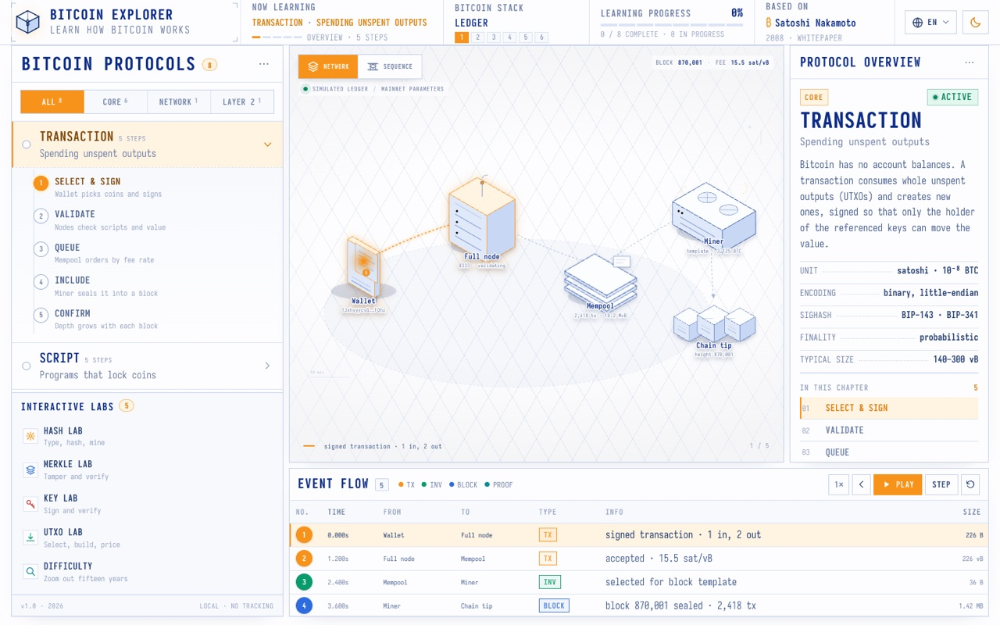
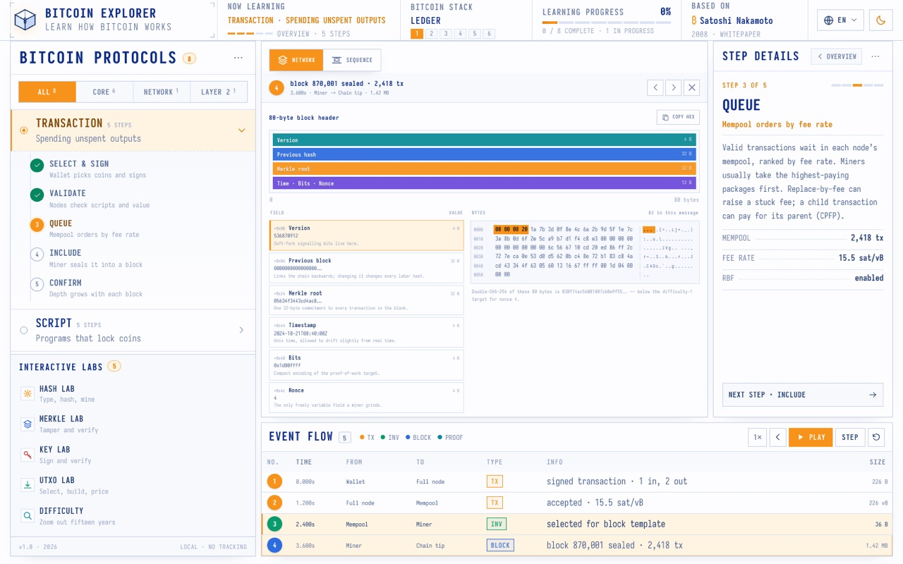
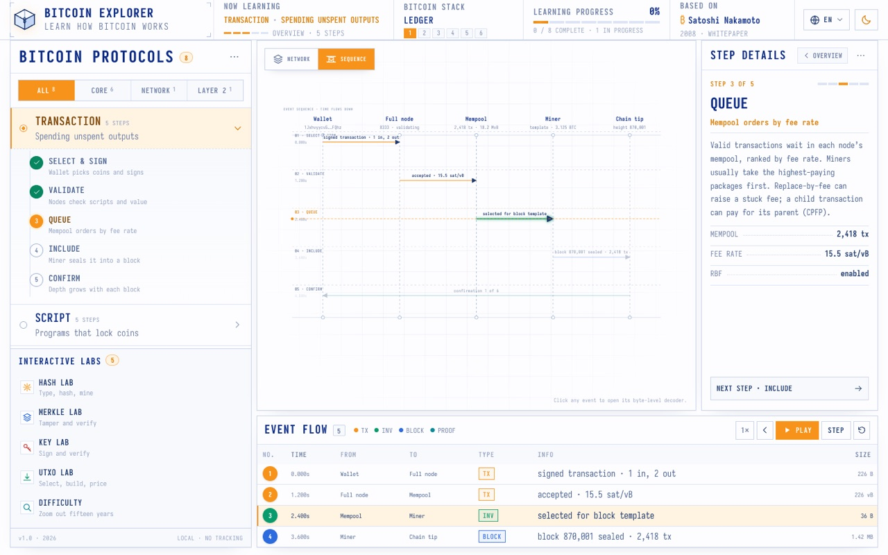
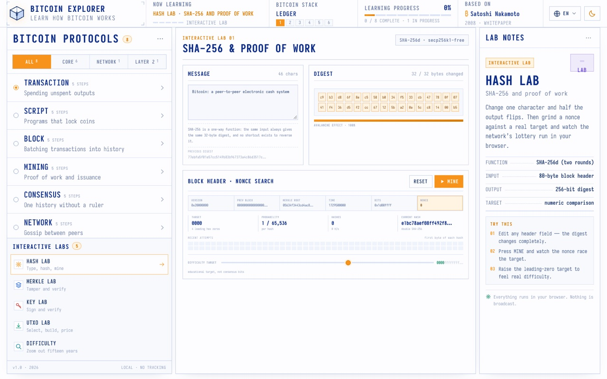
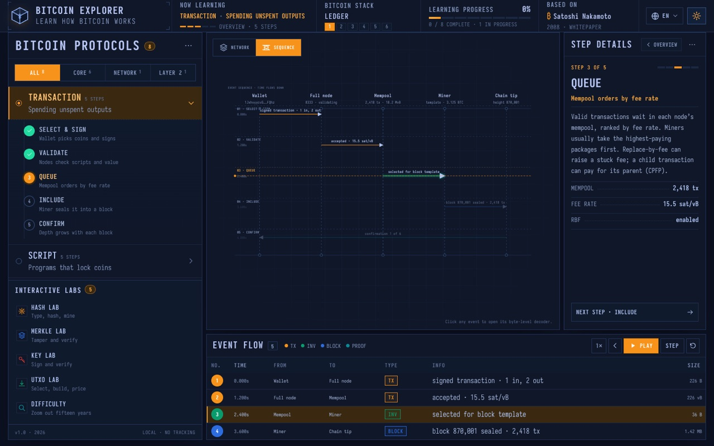
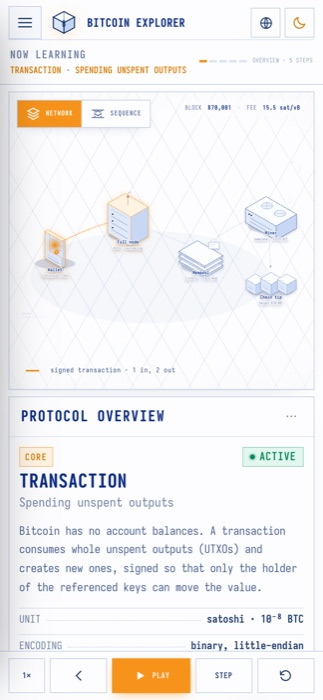

# Bitcoin Explorer

> An interactive, byte-level guide to how Bitcoin actually works — block by block.

**Bitcoin Explorer** is a self-hosted, browser-only learning site that animates transactions, scripts, blocks, mining, consensus, the peer-to-peer network, keys and the Lightning Network — then lets you open any event and decode its raw bytes. No accounts, no tracking, no server: everything (including the real cryptography) runs locally in your browser.

> **Reference / 参考源：** the interaction model, animation language and visual design are adapted from **[protocol-explorer-alpha](https://protocol-explorer-alpha.vercel.app/)** by **DilumSanjaya** (an educational "Protocol Explorer" for how the internet works) — the same blueprint/instrument-panel aesthetic, three-pane workspace, playback engine, sequence view and byte inspector, re-themed around Bitcoin. See [Credits](#credits) below.



> 中文说明：[README.zh-CN.md](README.zh-CN.md)

---

## Features

- **8 protocol chapters × 5 steps**, each an animated walkthrough with a step-by-step explanation panel.
- **5 interactive labs** using *real* cryptography in the browser:
  - **Hash Lab** — SHA-256 avalanche + a live proof-of-work nonce search.
  - **Merkle Lab** — tamper a leaf and watch the root change; verify an inclusion proof.
  - **Key Lab** — generate a keypair, sign and verify with `secp256k1`.
  - **UTXO Lab** — select coins, build and price a transaction, watch change/dust/fee math.
  - **Difficulty Lab** — seventeen years of difficulty and hashrate on an interactive chart.
- **Byte-level inspector** — click any event to see its field/value breakdown and a hex dump with field↔byte highlighting.
- **Sequence view** — a message-sequence diagram with flowing lifelines and a playhead.
- **Playback engine** — play / pause / speed (0.5×–2×) / step / reset, with keyboard shortcuts (`Space`, `←`, `→`, `N`, `S`).
- **Dark/light theme**, **English / 简体中文**, and **local progress** persistence.
- **Responsive** — a mobile drawer and a fixed playback bar on small screens.

## Screenshots

| | |
|---|---|
|  |  |
| Byte-level field/value + hex dump | Message-sequence diagram |
|  |  |
| Hash Lab — live nonce search | Dark theme |



## Tech stack

- [React 19](https://react.dev/) + [TypeScript](https://www.typescriptlang.org/) + [Vite](https://vite.dev/)
- [@noble/hashes](https://github.com/paulmillr/noble-hashes) — SHA-256, RIPEMD-160, HMAC
- [@noble/secp256k1](https://github.com/paulmillr/noble-secp256k1) — real ECDSA signing/verification
- [@scure/base](https://github.com/paulmillr/scure-base) — base58check / bech32 addresses
- Hand-written CSS (no framework), [Iosevka](https://typeof.net/Iosevka/) typeface

## Getting started

```bash
# install
npm install

# start the dev server
npm run dev

# production build
npm run build

# preview the build
npm run preview
```

The dev server runs on `http://localhost:5173` by default.

## Project structure

```
src/
  App.tsx                  # root state + playback engine
  components/              # TopBar, Sidebar, Scene, SequenceView,
                           # EventTable, Inspector, RightPanel, icons
  components/labs/         # HashLab, MerkleLab, KeyLab, UtxoLab, DifficultyLab
  data/
    chapters.ts            # all chapter/step/event/node content (EN + ZH)
    payloads.ts            # real tx / header / P2P / merkle / onion payloads
  lib/
    btc.ts                 # crypto + serialization (SHA-256d, P2PKH tx builder, …)
    format.ts              # hex / time helpers
  styles.css               # design system + all styling
ref/                       # Playwright scripts used to verify parity with the reference
```

## Chapters & labs

| # | Chapter | Description |
|---|---------|-------------|
| 1 | Transaction | Spending unspent outputs |
| 2 | Script | Programs that lock coins |
| 3 | Block | Batching transactions into history |
| 4 | Mining | Proof of work and issuance |
| 5 | Consensus | One history without a ruler |
| 6 | Network | Gossip between peers |
| 7 | Keys | Ownership is a signature |
| 8 | Lightning | Scaling with payment channels |

Interactive labs: **Hash Lab**, **Merkle Lab**, **Key Lab**, **UTXO Lab**, **Difficulty Lab**.

## Notes

- All simulation data is educational; protocol parameters (mainnet sizes, fees, difficulty, subsidy) are real.
- Nothing is broadcast, and no data leaves the browser.

## Credits

This project is a re-theming of **[protocol-explorer-alpha](https://protocol-explorer-alpha.vercel.app/)**, created by **DilumSanjaya**. The following are ported/adapted from that project and re-skinned around Bitcoin:

- the three-pane workspace and overall layout structure
- the playback engine and event/sequence timeline model
- the byte-level inspector and field↔hex highlighting
- the blueprint / instrument-panel visual aesthetic (Iosevka type, palette, borders)
- the easing curves (`cubic-bezier(.16,1,.3,1)` / `cubic-bezier(.5,0,.75,0)`) and motion keyframes (lane-flow, pending-sheen, dot-pop, step-in/step-spin/step-pop, caret, etc.)

All Bitcoin content — the eight protocol chapters, the five interactive labs, the transaction/block/script payloads, and the underlying cryptography — is original work for this project.

## License

[MIT](LICENSE)
