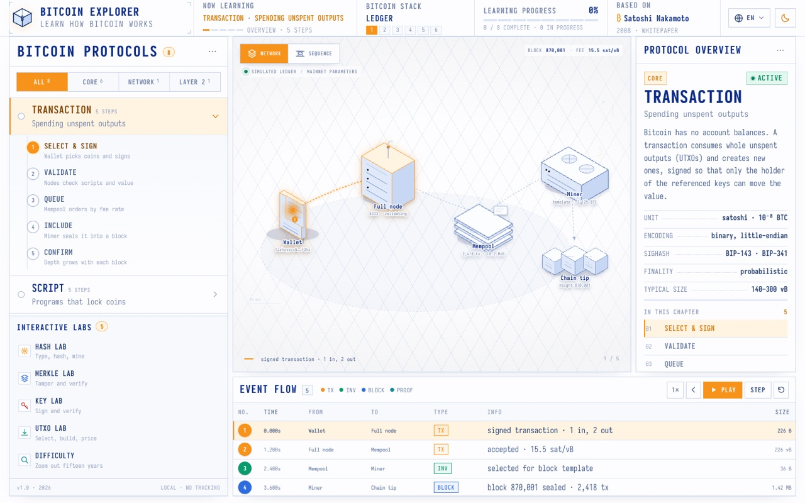
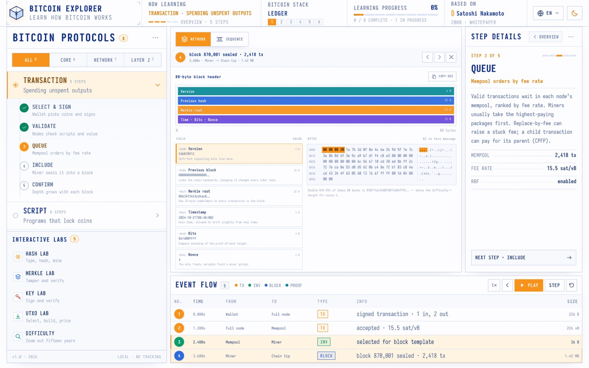
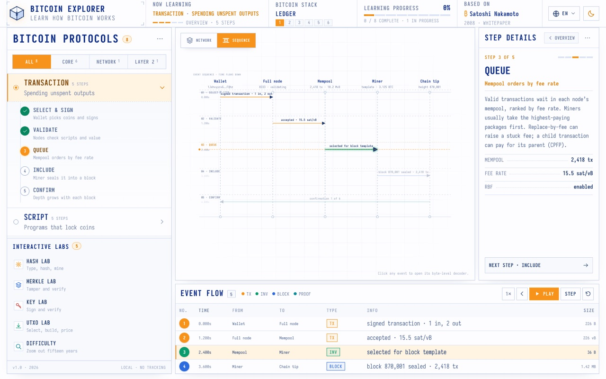
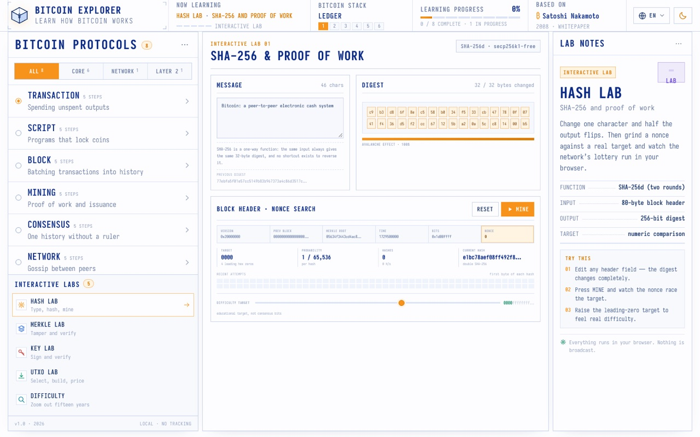
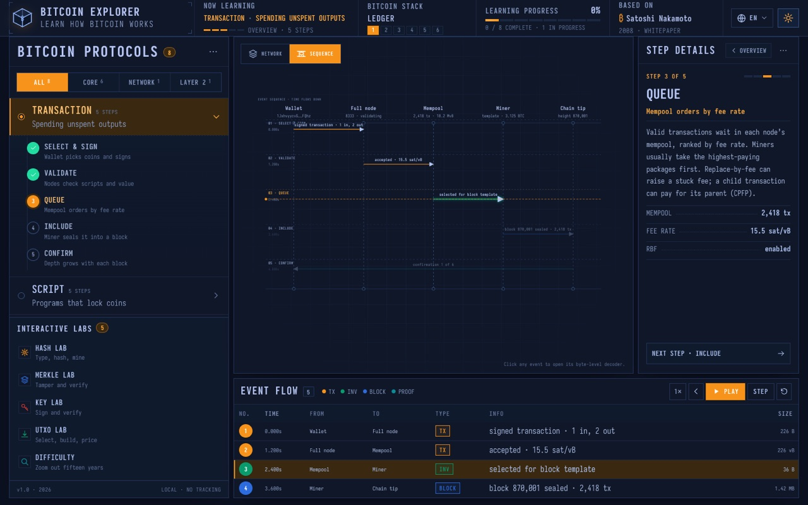
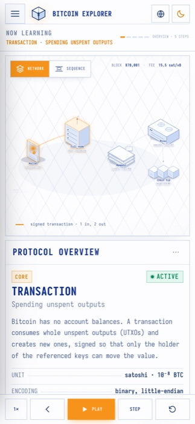

# Bitcoin Explorer

> 一份逐字节、可交互的比特币工作原理指南——一个区块一个区块地理解比特币。

**Bitcoin Explorer** 是一个完全在浏览器本地运行的学习站点：动画演示交易、脚本、区块、挖矿、共识、P2P 网络、密钥与闪电网络，并允许你点击任意事件、逐字节解码其原始数据。无需账号、无追踪、无服务器——包括真实密码学在内的一切都在浏览器中本地完成。

> **参考源：** 本项目的交互模型、动画语言与视觉设计均参考/改编自 **DilumSanjaya** 的作品 **[protocol-explorer-alpha](https://protocol-explorer-alpha.vercel.app/)**（一个讲解互联网工作原理的教育性 "Protocol Explorer"）——同样的蓝图/仪表盘美学、三栏工作区、播放引擎、时序视图与字节解码器，只是主题换成了比特币。详见下方 [致谢](#致谢)。



> English version: [README.md](README.md)

---

## 特性

- **8 章协议课程 × 每章 5 步**，每章都是一段带动画的分步讲解，并配有说明面板。
- **5 个交互实验**，使用浏览器内的**真实密码学**：
  - **哈希实验** —— SHA-256 雪崩效应 + 实时工作量证明 nonce 搜索。
  - **Merkle 实验** —— 篡改叶子观察根变化；验证包含证明。
  - **密钥实验** —— 生成密钥对，用 `secp256k1` 签名与验证。
  - **UTXO 实验** —— 选币、构造并计算一笔交易的费用，观察找零/粉尘/手续费。
  - **难度实验** —— 十七年的难度与全网算力交互图表。
- **逐字节解码器** —— 点击任意事件查看字段/数值拆解，以及字段↔字节高亮联动的十六进制转储。
- **时序视图** —— 带流动生命线与播放游标的消息时序图。
- **播放引擎** —— 播放 / 暂停 / 变速（0.5×–2×）/ 单步 / 重置，支持快捷键（`Space`、`←`、`→`、`N`、`S`）。
- **深色/浅色主题**、**英文 / 简体中文**、**本地进度**持久化。
- **响应式** —— 移动端抽屉菜单与固定播放栏。

## 截图

| | |
|---|---|
|  |  |
| 字段/数值 + 十六进制转储 | 消息时序图 |
|  |  |
| 哈希实验——实时 nonce 搜索 | 深色主题 |



## 技术栈

- [React 19](https://react.dev/) + [TypeScript](https://www.typescriptlang.org/) + [Vite](https://vite.dev/)
- [@noble/hashes](https://github.com/paulmillr/noble-hashes) —— SHA-256、RIPEMD-160、HMAC
- [@noble/secp256k1](https://github.com/paulmillr/noble-secp256k1) —— 真实 ECDSA 签名/验证
- [@scure/base](https://github.com/paulmillr/scure-base) —— base58check / bech32 地址
- 手写 CSS（无框架），字体 [Iosevka](https://typeof.net/Iosevka/)

## 快速开始

```bash
# 安装依赖
npm install

# 启动开发服务器
npm run dev

# 生产构建
npm run build

# 预览构建产物
npm run preview
```

开发服务器默认运行于 `http://localhost:5173`。

## 项目结构

```
src/
  App.tsx                  # 根状态 + 播放引擎
  components/              # TopBar、Sidebar、Scene、SequenceView、
                           # EventTable、Inspector、RightPanel、icons
  components/labs/         # HashLab、MerkleLab、KeyLab、UtxoLab、DifficultyLab
  data/
    chapters.ts            # 全部章节/步骤/事件/节点内容（中英双语）
    payloads.ts            # 真实交易 / 区块头 / P2P / Merkle / 洋葱包负载
  lib/
    btc.ts                 # 密码学与序列化（SHA-256d、P2PKH 交易构造等）
    format.ts              # 十六进制 / 时间工具
  styles.css               # 设计系统与全部样式
ref/                       # 用于对照参考站点做一致性验证的 Playwright 脚本
```

## 章节与实验

| 序号 | 章节 | 说明 |
|------|------|------|
| 1 | 交易 | 花费未花费输出 |
| 2 | 脚本 | 锁定比特币的脚本 |
| 3 | 区块 | 把交易写入历史 |
| 4 | 挖矿 | 工作量证明与发行 |
| 5 | 共识 | 没有统治者的唯一历史 |
| 6 | 网络 | 对等节点之间的 gossip |
| 7 | 密钥 | 所有权就是一个签名 |
| 8 | 闪电网络 | 用支付通道扩容 |

交互实验：**哈希实验**、**Merkle 实验**、**密钥实验**、**UTXO 实验**、**难度实验**。

## 说明

- 所有演示数据均为教学用途；协议参数（主网大小、手续费、难度、补贴）均为真实值。
- 不会广播任何内容，也不会有任何数据离开浏览器。

## 致谢

本项目是对 **DilumSanjaya** 创作的 **[protocol-explorer-alpha](https://protocol-explorer-alpha.vercel.app/)** 的比特币主题重制。以下内容移植/改编自该作品，并围绕比特币重新套皮：

- 三栏工作区与整体布局结构
- 播放引擎与事件/时序时间线模型
- 逐字节解码器与字段↔十六进制高亮联动
- 蓝图/仪表盘视觉美学（Iosevka 字体、配色、边框）
- 缓动曲线（`cubic-bezier(.16,1,.3,1)` / `cubic-bezier(.5,0,.75,0)`）与动效关键帧（lane-flow、pending-sheen、dot-pop、step-in/step-spin/step-pop、caret 等）

所有比特币内容——八章协议课程、五个交互实验、交易/区块/脚本负载，以及底层密码学——均为本项目的原创内容。

## 许可证

[MIT](LICENSE)
